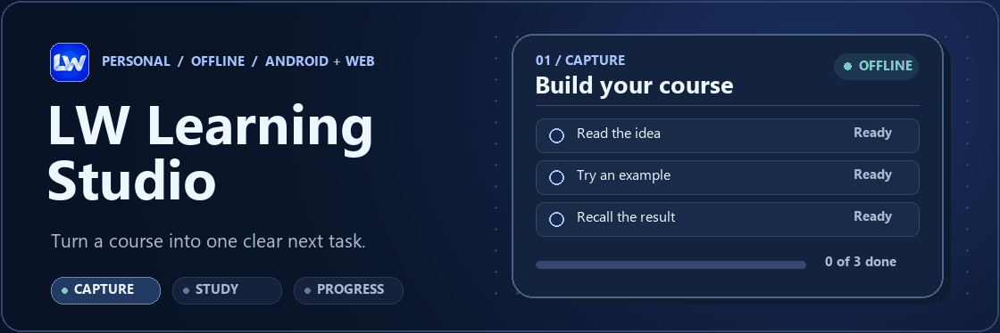
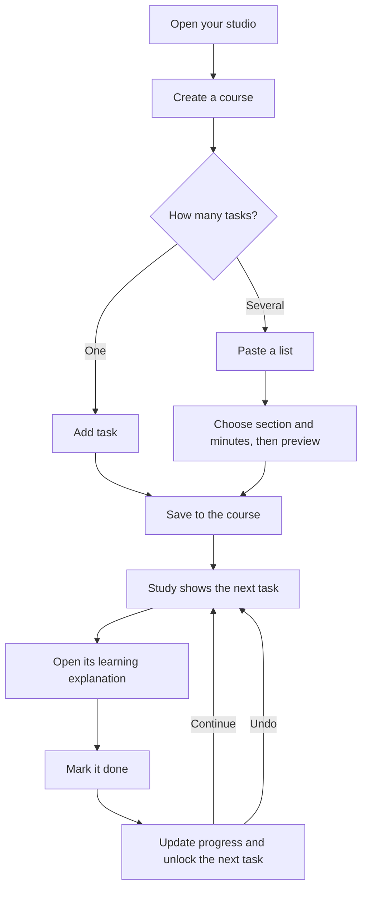
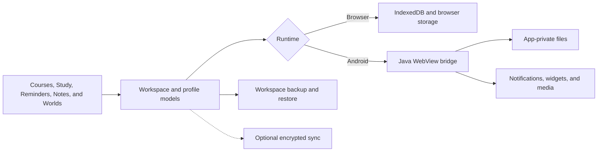

# LW Learning Studio



**LW Learning Studio is an offline-first study workspace for Android and the browser.** Create a course, add the tasks you want to learn, and work through them one at a time. Your notes, reminders, and progress belong to your local profile. A fresh workspace starts with zero courses, tasks, and progress.

This public repository includes the app source, bundled offline assets, automated tests, setup guides, and an optional standalone curriculum.

[Quick start](#quick-start) · [Study workflow](#study-workflow) · [Features](#features) · [Architecture](#architecture) · [Android build](#android-build)

## Quick start

Run the local preview from the repository root with Node.js 20 or newer. The preview has zero npm dependencies.

```sh
node outputs/Cyberpath/server.mjs
```

Open [localhost:4317](http://localhost:4317), enter a name, and choose **Open my studio**. Use **My courses** to create a course and **Study** to pick up the next task.

## Study workflow

Add a single task or paste a list. Bulk entry accepts a task name per line, `Task: What to learn`, or two tab-separated spreadsheet columns. Choose a section and estimated minutes, review the preview, then save the batch directly to the course. An invalid row is reported before any tasks are added. [Direct task entry guide](docs/SIMPLE-TASK-ENTRY.md)



## Features

| Area | What you can do |
| --- | --- |
| **Courses and study** | Add or reorder tasks, study one task at a time, undo completion, and attach lesson media or PDF worksheets. |
| **Planning and practice** | Set availability and deadlines, plan study blocks, schedule reminders, and review flashcards, questions, and mistakes. |
| **Notes and library** | Write offline notebook pages, attach files or audio, annotate PDFs, and search your library. |
| **Progress worlds** | Explore five views of your progress including Forest, Learning Islands, Knowledge City, Constellations, and Progress Orbs. |
| **Profiles and recovery** | Keep learners separate, export and restore workspace backups, and optionally pair devices through a configured encrypted sync server. |
| **Android integrations** | Use native reminders, widgets, file sharing, background audio controls, and local media features where the device supports them. |

[Study and profiles](docs/STUDY-PROFILES.md) · [Feature guide](docs/UPGRADES.md) · [Interface guide](docs/INTERFACE.md) · [Rollout tracker](docs/ADDON-ROLLOUT.md)

The optional **Cybersecurity & Hacking** pack includes 500 lessons, 100 section projects, and 1,600 tasks. The pack is separate from the empty workspace that ships with the app. [Course pack and study guide](outputs/LW-Packs/README.md#cybersecurity--hacking)

## Architecture

The app uses browser-native JavaScript modules, HTML, and CSS. Node.js serves the local preview, where a service worker caches the app shell and IndexedDB stores workspace records. Android packages the same web assets in a Java WebView. Its bridge handles app-private storage and native services.



| Path | Contents |
| --- | --- |
| [`outputs/Cyberpath/public/`](outputs/Cyberpath/public/) | Shared web UI, state models, offline shell, workers, and bundled runtime assets |
| [`outputs/Cyberpath/android/`](outputs/Cyberpath/android/) | Java wrapper, manifest, resources, and device integrations |
| [`outputs/Cyberpath/tests/`](outputs/Cyberpath/tests/) | Model, storage, workflow, and native regression checks |
| [`outputs/LW-Packs/`](outputs/LW-Packs/) | Course schema, validator, theme example, and the standalone cybersecurity curriculum |
| [`tools/`](tools/) | Test runner, Android packaging and QA scripts, and optional sync server |
| [`docs/`](docs/) | Feature guides, rollout history, screen inventory, and QA summaries |

## Tests

```sh
node tools/run_tests.mjs
```

The source has **330 automated checks**. A fresh browser-only checkout runs 329 and skips the Java app-lock check until the JDK tool config is available. [Direct task entry verification](docs/SIMPLE-TASK-ENTRY.md#verification) · [QA history](docs/QA.md)

## Android build

Use JDK 17, Android platform 35, and build-tools 35.0.0. If the local tool config already exists, reuse it. On a fresh clone, pass your installed paths and write the config under `work/`.

```sh
python tools/configure_android.py --sdk "/path/to/android-sdk" --java-home "/path/to/jdk-17" --output work/android-release/tools.json
```

If the platform 35 JAR is stored separately, pass its path with `--android-jar`.

The build expects a local signing key. For a fresh development install, create a key with the alias `skillgrove`. Use `keytool` from your JDK and run these commands in a POSIX shell or Git Bash.

```sh
mkdir -p outputs/Cyberpath/android/signing
keytool -genkeypair -keystore outputs/Cyberpath/android/signing/development.keystore -alias skillgrove -keyalg RSA -keysize 2048 -validity 10000 -storepass android -keypass android -dname "CN=LW Local Development"
node tools/build_apk.mjs --tools work/android-release/tools.json --output work/LW-local-check.apk
```

Keep signing keys and local build output outside Git. To update an existing phone install, sign with the same key that signed the installed app.

The current source includes direct task entry (`studio47`, shell `raw-v31`). A local Android build was signed and checked against all 411 packaged assets. Physical-device verification remains open.

## Third-party notices

Bundled libraries and language models include their licenses and provenance under [`public/vendor/`](outputs/Cyberpath/public/vendor/).
